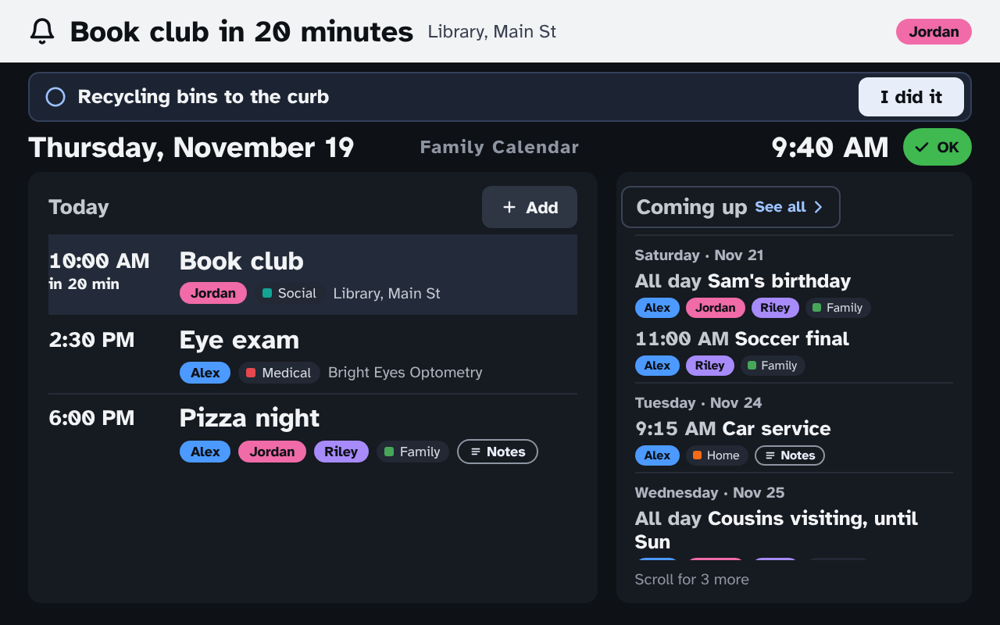

# N4MI Calendar Display

A self-hosted household calendar: a small server on the home network, a
browser editor that also works on a phone, and a shelf-mounted touch display
(Raspberry Pi 5 running Chromium in kiosk mode).

It is independent of Google, Apple and other cloud calendars. Google Calendar
is used only as a read-only import source, and only when the owner starts an
import.

*Names and events in the picture are made up.*

**Want to build one?** Start with [docs/building-your-own.md](docs/building-your-own.md).
It's shared as is, with no support promised; you're encouraged to tailor it with
your favourite AI agent.

## What's here

| Folder | Contents |
| --- | --- |
| `server/` | The calendar server (Python, FastAPI, SQLite), the editor pages, the display page, tests, Dockerfile and compose file. See [`server/README.md`](server/README.md). |
| `.github/workflows/` | Tests the server, then builds its Docker image and publishes it to GitHub Container Registry. |
| `docs/` | [Building your own](docs/building-your-own.md) and the [Raspberry Pi setup](docs/pi-setup.md). |
| `display/` | The Raspberry Pi side: kiosk and helper services, installer, and their tests. See [`display/README.md`](display/README.md). |

## Status

**Version 1.0** (November 2026), in daily use by one household since late
October 2026:

- **Editor:** events with one or more people, a category and an optional
  location; repeating events with single dates skipped or changed, or changed
  from a date on; reminders in minutes, hours or days, including for all-day
  events; household "I did it" reminders; people, categories and settings; a
  Tips page; a backup download. Works on a phone.
- **Shelf display:** Today, Coming up (with a See all panel reaching up to 12
  months ahead), reminder banners, "I did it" with Undo, add, move and delete
  on the touch screen, an offline copy with a clear stale indicator, night
  mode with the screen fully off, and a health button with Restart and Shut
  down.
- **Google import:** read-only, started by hand, reviewed before anything
  changes; a "Not in Google" list with a pre-filled Add to Google link; US
  holidays calculated on the server.
- **Raspberry Pi:** kiosk and helper as systemd user services, read-only file
  system, tested through repeated power cuts and an unattended week.

## Privacy

This repository holds code only. Real calendar data, database files, exports,
backups and import URLs are never committed. Tests and screenshots use
fictional data.

## Licence

MIT. See [LICENSE](LICENSE).
