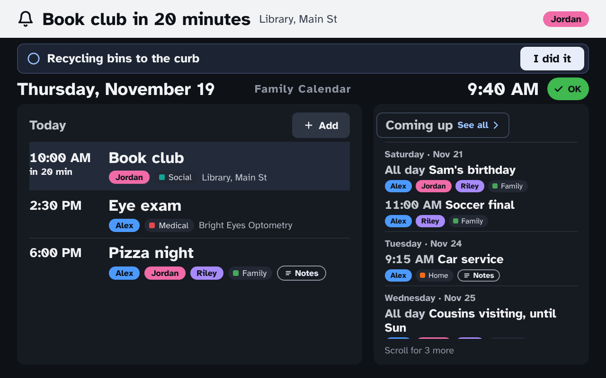
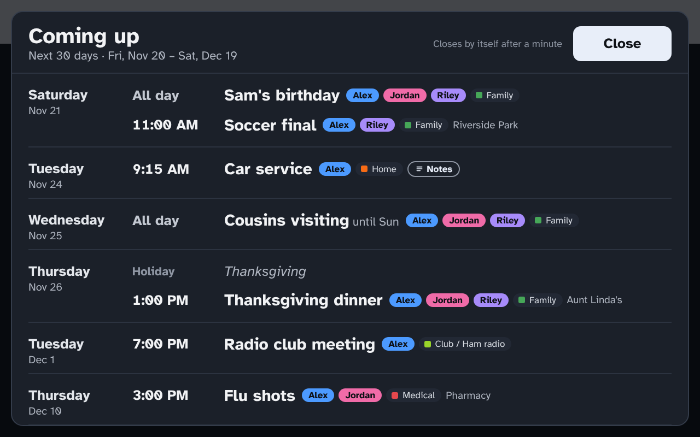
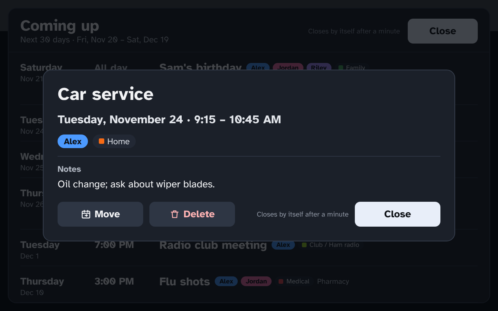
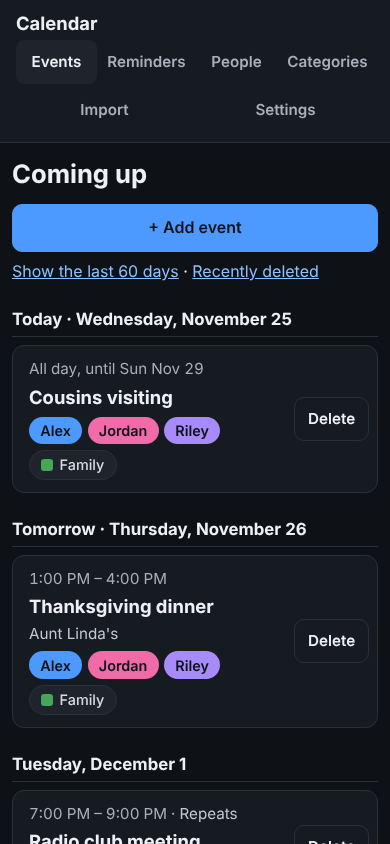

# Building your own

N4MI Calendar Display is a household calendar that lives on your own home
network: a small server holds the calendar, a browser editor (which also works
on a phone) does the managing, and a 10.1" touch screen on a shelf shows the
day at a glance. It doesn't depend on Google, Apple or any other cloud
calendar. Google Calendar can be used as a read-only import source, only when
you start an import.



*All names and events in these pictures are made up.*

## Offered as is

This was built for one household (mine) and is shared as is, with no support
promised. If you'd like to tailor it to your own environment and preferences,
you're encouraged to use your favourite AI agent to change the code. The map
for you and your agent is at the end of this page.

## What it does

- **On the shelf:** today's events, the next two weeks, reminder banners
  ("Dentist in 45 minutes"), household "I did it" reminders (for example
  "Garbage cans to the curb" every Monday), and a quiet "Nothing scheduled
  today" only when that's really true. If it can't reach the server it keeps
  showing the last schedule with a clear "Not updated since…" bar. At night it
  goes fully dark; a touch wakes it. Events away from home carry an "Out of
  town" tag and are reminded a few days earlier (5 to begin with).
- **Simple actions on the touch screen:** add (with one-tap titles and its own
  large-key keyboard), move, delete, tick off reminders, and **Coming up · See
  all** for the next 30 days and beyond.
- **A small health button** (green, amber or red, always with a word and a
  symbol) that opens the display's vital signs, with Restart and Shut down.
- **The editor:** events with one or more people, a category and a location;
  repeating events (weekly, monthly by weekday or date, yearly) with single
  dates skipped or changed; reminders in minutes, hours or days; people,
  categories and colours; settings; a Tips page; a backup download.
- **Google import (optional):** reads a Google calendar's private iCal address
  when you press Fetch, and lists what's new or changed for you to review.
  Nothing is merged, deleted or written to Google on its own. For a place it
  hasn't seen, it asks once whether it's local or out of town; towns on your
  local towns list never ask. A "Not in
  Google" list helps you copy events the other way by hand.

| The See all panel | Event details on the shelf | The editor on a phone |
| --- | --- | --- |
|  |  |  |

## Parts

What this one uses, with workable alternatives. Prices change, so none are
listed.

| Part | Used here | Alternatives |
| --- | --- | --- |
| Server | A small always-on Linux computer running Docker (here a mini-PC) | Any 64-bit PC or NAS that runs Docker. On a Raspberry Pi or other ARM computer, build the image yourself (see below). |
| Display computer | Raspberry Pi 5, 4 GB, with the Active Cooler, in an aluminium case | A Raspberry Pi 4 should manage the page, but wasn't tested. |
| Clock battery | Official Raspberry Pi 5 RTC battery (rechargeable) | Optional, but it keeps the time right through power cuts, which matters with the read-only setup below. |
| Storage | A small NVMe SSD in a USB 3 enclosure | The official M.2 HAT+ (this build dropped it: the PCIe ribbon wouldn't stay seated in the case); a good microSD card works but wears faster. |
| Screen | Elecrow 10.1" capacitive touch monitor, 1280×800, HDMI, touch over USB, on its own 5 V supply | Waveshare 10.1DP-CAPLCD (1280×800; documented as dimmable from the Pi, not tested here). Any 1280×800 HDMI touch monitor should work; check that it goes fully dark with no signal. |
| Stand | 3D-printed, holding the screen and the Pi's case | The screen's own stand, or a wall mount. |

The page is designed for **1280×800 landscape**. Other sizes will work but may
need the text sizes adjusted.

## Run the server

The server is one Docker container. Its image is published publicly at
`ghcr.io/n4mi73/n4mi-calendar-display`, built for **64-bit Intel/AMD
(linux/amd64)** only.

1. Make a folder for the database and give it to user ID 1000 (the container
   runs as that user):

   ```bash
   mkdir -p ~/calendar/data
   sudo chown 1000:1000 ~/calendar/data
   ```

2. Save this as `~/calendar/docker-compose.yml`, changing the time zone to
   yours:

   ```yaml
   services:
     calendar:
       image: ghcr.io/n4mi73/n4mi-calendar-display:latest
       restart: unless-stopped
       ports:
         - "8087:8087"
       environment:
         - TZ=America/New_York
         # - CAL_SOURCE_1_URL   (only for Google import; see below)
       volumes:
         - ./data:/data
   ```

3. Start it: `cd ~/calendar && docker compose up -d`, then open
   `http://SERVER-ADDRESS:8087` in a browser. The editor opens on the Events
   page.

**On a Raspberry Pi or another ARM computer**, build the image from a copy of
this repository instead, and point the compose file at it:

```bash
git clone https://github.com/N4MI73/n4mi-calendar-display.git
docker build -t n4mi-calendar-display n4mi-calendar-display/server
```

Then use `image: n4mi-calendar-display` (and no `pull_policy`) in the compose
file.

**Keep it on your home network.** There's no login: anyone who can reach port
8087 can change the calendar. Don't forward it through your router. For access
away from home, a private network such as Tailscale, limited to your own
devices, is the approach used here.

**Back it up.** The whole calendar is one SQLite file in the data folder. Copy
it with a proper SQLite backup (not a raw copy of the live file), or use
Settings → **Download a backup** in the editor. Putting a backup back is
described in [`server/README.md`](../server/README.md) under "Database and
backups".

## First run

In the editor:

1. **People:** add the people in your household, each with a colour. Every
   event belongs to at least one person.
2. **Categories:** eight are already there (Medical, Family, Home, Social,
   Travel, Club / Ham radio, Info, Other). Rename, recolour or add your own,
   and set each one's default reminder.
3. **Settings:** night (dark) hours, how far ahead "Coming up" looks and the
   title shown on the display; under Out of town, replace the **Local towns**
   (it starts with the builder's own towns in Georgia) with yours; under
   Settings → More, which US holidays to show (or none).
4. **Events and reminders:** add a few, then open
   `http://SERVER-ADDRESS:8087/display` in a browser to see the shelf view.
5. **Phone:** open the editor on your phone and use "Add to Home Screen" for
   an app-like icon.

The **Tips** page (Settings → More → Tips) explains the less obvious things,
such as "every Friday except the first".

**Google import (optional):** in Google Calendar on a computer, open Settings,
choose your calendar under "Settings for my calendars", and copy **Secret
address in iCal format** (not the public one). Treat it as a password: set it
only as the `CAL_SOURCE_1_URL` environment variable on the server (never in a
file you share), restart the container, and use **Import** in the editor.

## Set up the display

The Raspberry Pi runs Chromium full screen, pointed at the server's display
page, plus a small helper that reports the Pi's health, switches the screen off
during dark hours and handles Restart and Shut down. The full setup, including
the read-only file system that makes power cuts harmless, is in
[`docs/pi-setup.md`](pi-setup.md).

Two things differ for your own build:

- **Your server's address.** The Pi files point at this household's server.
  After running the installer, give both services your address with small
  override files, which survive updates (replace the address with yours):

  ```bash
  systemctl --user edit calendar-agent
  #   add:   [Service]
  #          Environment=CAL_SERVER=http://SERVER-ADDRESS:8087
  systemctl --user edit calendar-kiosk
  #   add:   [Service]
  #          Environment=CAL_URL=http://SERVER-ADDRESS:8087/display?kiosk=1
  ```

  Then restart the Pi (with the read-only file system off, if you've turned
  it on).
- **Your monitor.** Night mode switches the Pi's HDMI output off. Check that
  your monitor goes fully dark with no signal, rather than showing a lit "No
  signal" message, and that a touch still reaches the Pi while it's dark.

## Tailored to one household

Some things are fixed by design. Change them if you need to, knowing why they
are the way they are:

- **No login or PIN.** It assumes a trusted home network. Adding accounts
  would be a real change.
- **Home network only.** The server never needs to be reachable from the
  internet, and the display page loads nothing from the internet.
- **The server's database is the only true copy.** Google is read from, never
  written to.
- **The shelf stays simple.** Repeats, imports, people, categories and settings
  live in the editor, not on the touch screen.
- **Household reminders are deliberately narrow:** one line, one tap, no
  lists, priorities, assignments or history. It isn't a chore tracker.
- **English, US dates and times, US holidays,** and one time zone for the
  whole calendar.
- **Designed for 1280×800,** viewed from across a room, by someone who isn't
  technical and shouldn't need to be.

## If you change the code

For you and your AI agent, these are the map:

- [`server/README.md`](../server/README.md): how it's deployed, the settings,
  the database and backups, the display API (`/api/v1/display`), Google
  import, and how each feature behaves.
- [`server/tests/`](../server/tests/): plain Python tests for every feature,
  including repeating events across daylight-saving changes, imports, and the
  display data. Run them with
  `cd server && python -m unittest discover -s tests` (after `pip install -r requirements-dev.txt`).
- [`display/`](../display/) and [`docs/pi-setup.md`](pi-setup.md): everything
  on the Pi.

Licence: MIT (see [LICENSE](../LICENSE)).
